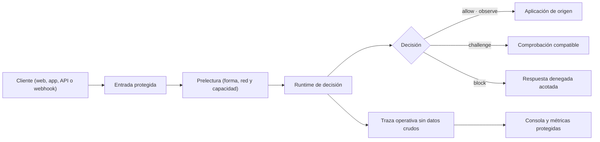
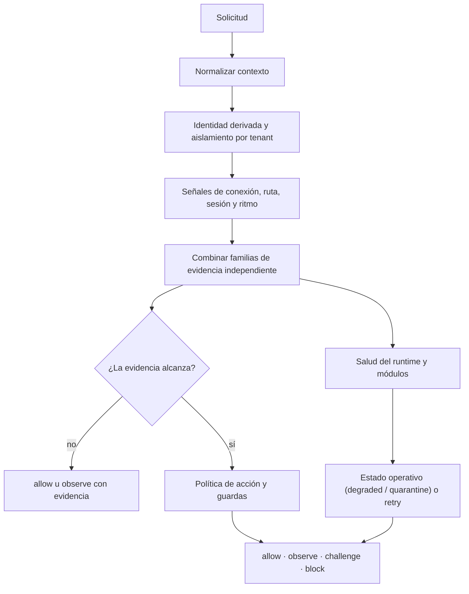

# Arquitectura pública

Esta vista explica el recorrido de AbuseShield `0.1.7` sin exponer nombres internos ni detalles que ayuden a esquivar controles. Para una introducción orientada a tareas, consulta [Cómo funciona](guias/como-funciona.md) y [Cómo están conectadas las piezas](guias/arquitectura.md).

## Recorrido de una solicitud

La consola y la telemetría son salidas de operación. No son una segunda entrada hacia la aplicación.

## Qué ocurre dentro del runtime

## Decisiones públicas vs estado operativo

Fuente canónica: [Canon de decisiones](reference/decision-canon.md).

| Categoría | Valores | Significado |
| --- | --- | --- |
| Decisiones de seguridad | `allow`, `observe`, `challenge`, `block` | Veredicto público sobre la solicitud dentro de un alcance concreto |
| Resultado operacional | `retry` | Espera indicada (`Retry-After`) cuando el estado compartido del challenge no está disponible; no es veredicto contra el cliente |
| Estado del servicio o módulo | `degraded`, `quarantine` | Capacidad reducida de una dependencia o módulo; no equivale a riesgo del visitante |

## Fronteras que deben mantenerse

- La entrada pública es la única puerta hacia el origen
- La aplicación no confía en cabeceras de transporte o fingerprints que el cliente pueda escribir (`ABUSE_SHIELD_TRUST_CLIENT_HEADERS=false`, `ABUSE_SHIELD_TRUST_EDGE_FINGERPRINT_HEADERS=false`)
- Los proxies confiables se declaran por red (`ABUSE_SHIELD_PROXY_CIDRS` / `ABUSE_SHIELD_TRUSTED_PROXY_CIDRS`), no por una cabecera cualquiera
- La consola requiere frontera loopback o credencial y no se publica en `core`
- Redis coordina el estado compartido cuando está disponible; el fallback local se marca explícitamente como degradado
- La telemetría usa identificadores derivados por tenant, límites y retención definida

## Redes compartidas

Hoteles, oficinas, campus, operadores móviles, VPN y CGNAT pueden poner a muchas personas detrás de una misma dirección pública. Por eso una IP aporta contexto de red, pero no basta para bloquear a todos.

## Qué no debe inferirse

Un fingerprint no identifica por sí solo a una persona. Un challenge superado no concede confianza permanente. Una señal ausente no prueba abuso. La decisión conserva alcance, motivo, módulos participantes y nivel de evidencia.
