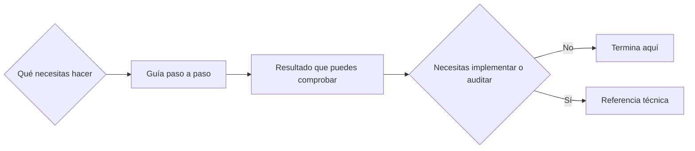
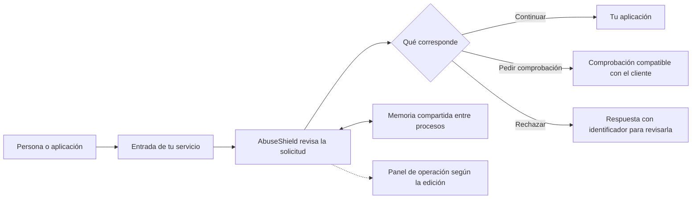

# Usar AbuseShield

Empieza por un recorrido corto. La referencia técnica queda separada para cuando
necesites cambiar un contrato, una señal o una frontera de confianza

Las guías explican una tarea completa, quién debe hacer cada parte y cómo saber
si terminó. La referencia conserva nombres exactos, formatos, fórmulas y casos
de fallo para quien implementa o revisa el sistema

## Empezar

| Quiero | Recorrido |
|---|---|
| Entender qué hace antes de instalarlo | [Cómo funciona](como-funciona.md) |
| Levantarlo y comprobar la primera solicitud | [Tu primera hora](primera-hora.md) |
| Elegir qué servicios mantener | [Elegir una edición](ediciones.md) |
| Llevarlo a una máquina propia o alquilada | [Instalar en un servidor](servidor.md) |

El primer arranque puede generar y conservar sus propias claves. Publicarlo en
Internet es un paso posterior que necesita HTTPS y un origen sin acceso público
alternativo

## Conectar una aplicación

Empieza por [elegir el tipo de aplicación](conectar-aplicacion.md) y continúa por
un solo camino

| Cliente | Guía de uso | Estado actual |
|---|---|---|
| Web o Laravel | [Conectar una web](web.md) | Integración servidor disponible |
| API, webhook o WebView | [Conectar un cliente limitado](api-webview.md) | Contrato HTTP disponible, adaptación del cliente necesaria |
| Android | [Conectar Android](android.md) | Cliente Kotlin y servidor disponibles; validación final de Google pendiente |
| iOS | [Conectar iOS](ios.md) | Adaptador App Attest disponible, biblioteca y verificador pendientes |

## Entender las decisiones

| Pregunta | Guía |
|---|---|
| Cómo se conectan entrada, memoria y aplicación | [Cómo están conectadas las piezas](arquitectura.md) |
| Qué observa y qué no puede concluir | [Señales y límites](senales.md) |
| Qué se guarda y qué debes ocultar | [Privacidad y datos](privacidad.md) |
| Qué configuración debe impedir el arranque | [Mantener una instalación segura](seguridad.md) |
| Dónde cambiar una opción sin mezclar responsabilidades | [Configurar sin perder el camino](configuracion.md) |

## Operar y cambiar

| Tarea | Guía |
|---|---|
| Entrar al panel o usar claves propias | [Claves y acceso](claves.md) |
| Revisar una decisión o una dependencia caída | [Trabajo diario](operar.md) |
| Resolver un arranque o una ruta que no responde | [Resolver problemas](problemas.md) |
| Saber qué demuestra cada prueba | [Probar una integración](probar.md) |
| Actualizar, copiar o volver atrás | [Cambios y recuperación](cambios.md) |

## Cómo encajan las piezas

Este dibujo describe la integración: arrancar los contenedores no conecta por
sí solo una tienda, una API o una app que ya tengas. Sigue
[Conectar tu aplicación](conectar-aplicacion.md) para elegir el camino correcto.

## Ir más profundo

La [referencia técnica](../reference/README.md) lleva a arquitectura, motores,
configuración, API y contratos móviles. Las guías de esta carpeta explican tareas
y resultados observables; la referencia define los detalles que deben coincidir
con el código.
