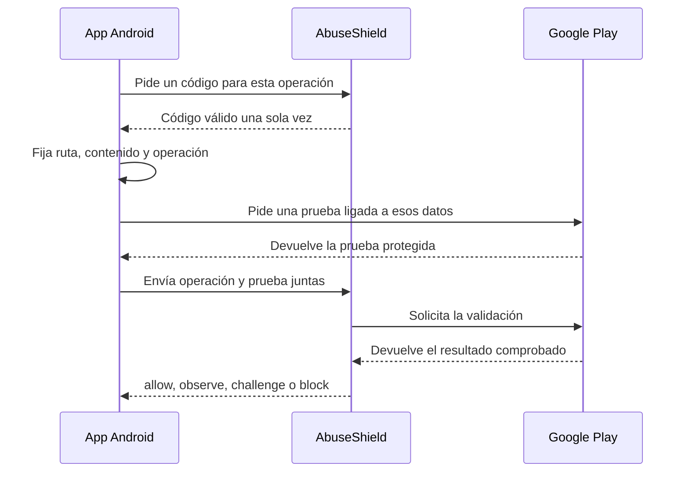

# Conectar una app Android

Hay dos integraciones distintas. Puedes proteger las solicitudes que la app
envía a tu servidor sin publicar la app en Google Play. Si además quieres
comprobar la integridad de la app, hay un cliente Kotlin y un verificador de
Play Integrity. Esa segunda parte exige configuración y pruebas adicionales.

## Estado de esta integración

El servidor y el cliente Kotlin de integridad están implementados. El módulo
`clients/android/sdk` fija los bytes de la solicitud, calcula la huella que
espera el servidor, pide la prueba a la biblioteca oficial de Google y produce
la cabecera final. La aplicación conserva su cliente HTTP y decide cuándo pedir
el código de un solo uso

El contrato se ejecutó en un Samsung A07 físico. Un diagnóstico separado
obtuvo un token de Google, que el servidor decodificó. Google marcó la APK
instalada por ADB como versión no reconocida. Esa observación no valida la
integridad de una app de terceros ni autoriza activar `enforce`.

## Primero: proteger la API

AbuseShield corre delante de tu servidor, no dentro del teléfono. La app
continúa usando su cliente HTTP habitual. Para este recorrido no necesitas
Play Console, una cuenta de servicio ni instalar el SDK Kotlin.

Desde un checkout nuevo, con Docker Engine y Compose disponibles:

```bash
./abuseshield up core
./abuseshield doctor core
./abuseshield integrate android --check
```

`up` construye la edición, genera las claves faltantes con un generador
criptográfico y las conserva en un volumen de Docker. No hace falta crear
`.env` para ese primer arranque. `setup core` es el camino alternativo para
quien quiera administrar variables de forma explícita; no lo ejecutes encima
de una instalación existente para rotar claves. No uses `down --volumes`
para un reinicio normal: borra también el volumen de secretos y estado.

Tu API debe atravesar la entrada protegida y el origen debe quedar privado.
La integración incluida hoy es Laravel/PHP; el Compose de ejemplo no convierte
automáticamente una API externa en un origen protegido. Comprueba el recorrido
con una solicitud de la app y verifica que no exista una URL alternativa que
llegue directamente a la API. Sigue [Conectar tu aplicación](conectar-aplicacion.md)
y la [guía para API y WebView](api-webview.md) para el lado servidor.

Una conexión HTTP correcta demuestra transporte, no que una solicitud haya sido
evaluada ni que el teléfono sea confiable. Conserva el código HTTP, la acción y
el identificador de correlación que entregue el servidor, sin registrar datos
personales o credenciales.

## Después: integridad de la app, si la necesitas

Esta parte liga una operación concreta a un token de Play Integrity. No es
necesaria para proteger la API. En una app que todavía no está en Play puedes
desarrollar y probar el transporte, pero una APK instalada por ADB puede ser
marcada como versión no reconocida. Mantén la evaluación en `shadow` hasta
probar la build, firma y distribución que realmente usarán tus usuarios.

Necesitas el package name de la app, un proyecto de Google Cloud con Play
Integrity habilitado, el número de proyecto para el cliente y una cuenta de
servicio autorizada para decodificar tokens en el servidor. Para la distribución
por Google Play, vincula la app en Play Console y valida ese canal. No tomes
un resultado de integridad de dispositivo como prueba de integridad de la app.

### Recorrido



### Preparar el servidor

Ejecuta desde la raíz del repositorio

```bash
./abuseshield up operations
./abuseshield integrate android --check-provider
```

Copia la lista de ejemplo a una ubicación privada, cambia cuenta, identificador
de paquete, operaciones, métodos, rutas y vencimiento. Después genera una clave
de firma fuera de la carpeta del proyecto

```bash
cp docs/integrations/mobile-registry.unsigned.example.json /ruta/privada/mobile-registry.json
php scripts/mobile-registry.php keygen \
  --key-ref android-registry-2026 \
  --private /ruta/privada/mobile-registry.key \
  --keyring deploy/mobile-config/keyring.json
php scripts/mobile-registry.php sign \
  --registry /ruta/privada/mobile-registry.json \
  --private /ruta/privada/mobile-registry.key \
  --output deploy/mobile-config/mobile-registry.signed.json
php scripts/mobile-registry.php verify \
  --registry deploy/mobile-config/mobile-registry.signed.json \
  --keyring deploy/mobile-config/keyring.json
```

La clave privada no entra en los contenedores. Guarda únicamente la lista
firmada y las claves públicas en `deploy/mobile-config/`. El ejemplo requiere
editar el registro para tu tenant, package name, métodos y rutas antes de
firmarlo; no habilites operaciones de prueba en producción.

Coloca la cuenta de servicio en:

```text
deploy/mobile-secrets/google-play-service-account.json
```

Limita el archivo al usuario que opera Docker y no lo añadas a Git

### Activar solo observación

Si ya arrancaste `operations` sin `.env`, crea uno vacío con permisos privados
antes de añadir estas variables:

```bash
test -e deploy/editions/operations/.env || (umask 077; touch deploy/editions/operations/.env)
```

No copies `.env.example` tal cual: contiene claves de ejemplo que el arranque
rechaza. Tampoco ejecutes `setup operations` después de generar claves en el
volumen; no es un procedimiento de rotación. Si el archivo ya existe, conserva
sus valores y añade solo lo que falta. En `deploy/editions/operations/.env`:

```dotenv
ABUSE_SHIELD_MOBILE_INTEGRITY=true
ABUSE_SHIELD_MOBILE_REQUIRE_SHARED_STATE=true
ABUSE_SHIELD_MOBILE_REGISTRY_MODE=shadow
ABUSE_SHIELD_MOBILE_REGISTRY_PATH=/run/abuseshield-mobile/mobile-registry.signed.json
ABUSE_SHIELD_MOBILE_REGISTRY_KEYRING_PATH=/run/abuseshield-mobile/keyring.json
ABUSE_SHIELD_MOBILE_PROVIDERS=play_integrity
ABUSE_SHIELD_GOOGLE_PLAY_INTEGRITY=true
ABUSE_SHIELD_GOOGLE_PLAY_CREDENTIALS_PATH=/run/abuseshield-mobile-secrets/google-play-service-account.json
```

Levanta de nuevo la edición. El production guard debe rechazar archivos ausentes,
ilegibles o una combinación insegura

`shadow` significa que la comprobación se ejecuta y deja evidencia, pero todavía
no endurece la decisión para una persona

```bash
./abuseshield up operations
./abuseshield status operations
./abuseshield integrate android --check-provider
```

### Añadir el cliente Android a la app

Publica el módulo en el repositorio Maven local desde este checkout

```bash
cd clients/android
./gradlew :sdk:testDebugUnitTest :sdk:publishToMavenLocal
```

Añade `mavenLocal()` a los repositorios de tu proyecto Android y después
declara el artefacto. El módulo incluye Play Integrity `1.6.0`.

```kotlin
dependencies {
    implementation("io.abuseshield:abuseshield-android:0.1.7-internal")
}
```

Prepara `GooglePlayIntegrityTokenSource` al abrir la app, no dentro del botón de
login o pago. Usa el número de proyecto de Google Cloud y puede tardar varios
segundos

Para cada operación:

1. crea una sola vez el contenido que realmente enviarás
2. pide el código de un solo uso en `POST /abuseshield/mobile/nonce`
3. convierte la respuesta en `MobileNonce`
4. llama `AbuseShieldPlayIntegrityClient.protect(request, nonce)`
5. añade la cabecera devuelta a la solicitud original

El cliente calcula el binding, llama `setRequestHash(...)`, limita la forma del
token devuelto y construye el sobre. La autenticidad del token se valida en el
servidor, nunca en la app. El módulo no incluye una biblioteca de red porque debe
usar la misma autenticación, timeouts y política de reintentos de tu app

No vuelvas a construir el JSON después de calcular la huella. Cambiar el orden,
los parámetros, el contenido o la ruta produce otra huella y el servidor debe
rechazarla

### Probar una operación

Empieza por una operación no destructiva o una cuenta de prueba

| Caso | Resultado esperado |
|---|---|
| Build legítima por el canal previsto | Token decodificado y binding coincidente |
| Mismo token o nonce repetido | Rechazo por reutilización |
| Body modificado después del hash | Binding inválido |
| Dos envíos simultáneos | Uno reserva el nonce y el otro espera o falla de forma acotada |
| Google responde `429` o `5xx` | Reintento con espera, sin condenar al usuario |
| Cambio Wi-Fi a datos | La sesión conserva contexto; la IP nueva no basta para bloquear |
| Play Integrity no disponible | Evidencia ausente y degradación visible |

Conserva código HTTP, acción y correlation ID. No registres el token de Google,
el body sensible ni la credencial de servicio

### Pasar de observar a aplicar

Cambia de solo observar (`shadow`) a aplicar (`enforce`) solo después de ver
dispositivos legítimos, errores del proveedor y reinstalaciones. Empieza con una
operación y una versión de la app

La ausencia de Play Integrity no debe convertirse por sí sola en bloqueo. La
política combina el resultado con el contexto de la operación

## Diagnóstico

| Síntoma | Causa probable |
|---|---|
| `422` al pedir nonce | App, operación, método o ruta no coincide con el registro |
| `429` | Presupuesto de emisión agotado; respeta `Retry-After` |
| `503` | Redis, OAuth o Google no están disponibles |
| Prueba válida con huella inválida | La solicitud cambió después de calcular `requestHash` |
| Funciona local pero no en la build publicada | Proyecto, package name, firma o canal no coinciden |
| Proveedor inválido después de horas | Vuelve a preparar `StandardIntegrityTokenProvider` |

## Cierre

- la lista y sus claves públicas verifican la firma
- la credencial no aparece en Git, logs ni `docker inspect`
- una build real obtiene un token de Google
- el servidor compara package name, antigüedad y binding
- reutilización, cambio de contenido y cambio de operación se rechazan
- caída del proveedor es visible y recuperable
- la activación puede volver a `shadow` sin redeploy de la app

Hasta completar todos los puntos, conserva `shadow`. El diagnóstico en el A07
sí recibió y decodificó un token real, pero no obtuvo una versión de app
reconocida. Ninguna prueba de este repositorio sustituye una validación de tu
propia app en el canal de distribución previsto.

Los bytes, campos y estados exactos están en la
[referencia técnica de Android](../integrations/android.md) y en el
[README del SDK](../integrations/android.md).

Fuentes del proveedor: [configuración de Play Integrity](https://developer.android.com/google/play/integrity/setup?hl=es-419)
y [solicitudes estándar](https://developer.android.com/google/play/integrity/standard)
