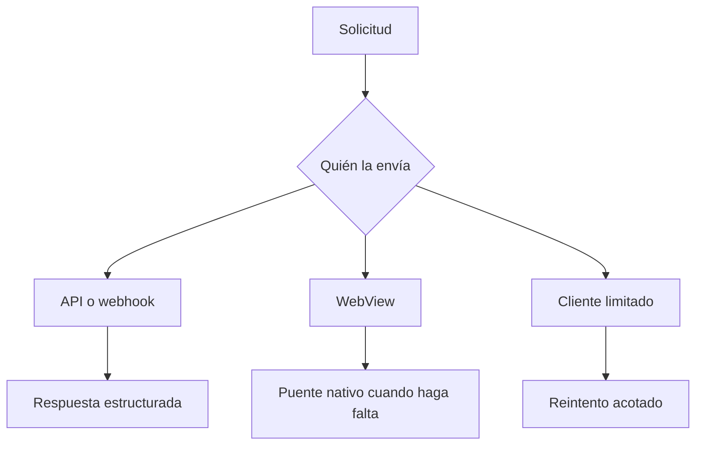

# Conectar una API, webhook o WebView

Esta guía es para clientes que no siempre pueden mostrar una página, ejecutar
JavaScript o conservar cookies. Su respuesta debe poder resolverse sin fingir
que existe un navegador completo

## Elegir el perfil

| Cliente | Conserva | No debes exigir |
|---|---|---|
| API de una app | JSON, autenticación y reintentos | HTML o cookies de navegador |
| Webhook | Firma, timestamp y entrega entre servidores | Interacción humana |
| WebView | Vista web y puente con la app | Almacenamiento estable o APIs completas |
| Tarea en segundo plano | Contexto de la app y red | Pantalla abierta |
| Dispositivo limitado | Operaciones cortas | Trabajo criptográfico costoso |



## Preparar el servidor

```bash
./abuseshield status operations
./abuseshield integrate api --check
```

La autenticación existente no cambia. Una clave de API, sesión o firma de
webhook sigue siendo necesaria aunque AbuseShield admita la solicitud

## Implementar el cliente

Para cada respuesta conserva código HTTP, acción pública, `Retry-After` cuando
exista y `X-Correlation-ID`

| Acción | Conducta |
|---|---|
| `allow` | Continúa normalmente |
| `observe` | Continúa sin pedir trabajo adicional |
| `challenge` | Ejecuta la comprobación indicada o reintenta según el contrato |
| `block` | Detén la operación y muestra una referencia de soporte |

No abras una WebView al recibir cualquier challenge. Una API puede requerir un
reintento temporal y una app instalada puede necesitar Play Integrity o App
Attest

## Webhook

1. valida la firma del proveedor
2. rechaza timestamps vencidos y replays
3. usa una ruta y límites propios
4. trata la regularidad como comportamiento esperado, no como automatización hostil
5. conserva correlación sin registrar el body ni el secreto

## WebView

El código nativo debe conservar credenciales y comprobaciones móviles. La vista
puede iniciar una operación, pero no recibe secretos del proveedor ni decide la
cuenta interna del despliegue

Prueba cookies bloqueadas, JavaScript ausente, pérdida de almacenamiento,
background y cambio entre Wi-Fi y datos móviles. Esos estados reducen capacidad;
no prueban abuso por sí solos

## Declarar capacidad desde un proxy propio

Un proxy autenticado puede declarar un cliente limitado mediante un perfil y un
secreto montado en ese proxy. No copies ese secreto dentro de JavaScript o de una
app distribuida

```http
X-AbuseShield-Client-Profile: constrained_device
X-AbuseShield-Client-Token: <secreto del proxy>
```

Una declaración sin firma válida se ignora y nunca reduce riesgo

## Comprobar

- `Accept: application/json` nunca recibe una página inesperada
- `Accept: */*` sigue obteniendo una respuesta interpretable
- los reintentos respetan espera y tienen un máximo
- repetir el mismo webhook no ejecuta dos veces la operación
- perder JavaScript o cookies no produce un bloqueo permanente
- una caída de la comprobación móvil aparece como no disponible
- la autenticación de tu aplicación continúa siendo obligatoria

## Cierre

- cada tipo de cliente recibe una respuesta que puede interpretar
- `challenge` no obliga a abrir HTML cuando el cliente no es un navegador
- firma, sesión o clave propia siguen validándose antes de ejecutar la operación
- reintentos tienen espera, límite y protección contra ejecución duplicada
- una dependencia caída queda visible sin convertirla en evidencia hostil
- el identificador de correlación permite reconstruir una solicitud completa

La [referencia técnica de API y WebView](../integrations/README.md#api-webhook-y-webview)
define cabeceras, perfiles privados y el sobre móvil
