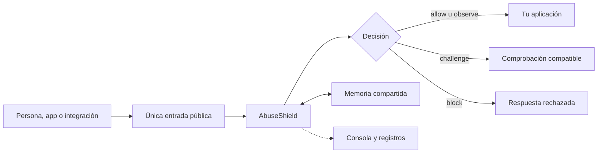
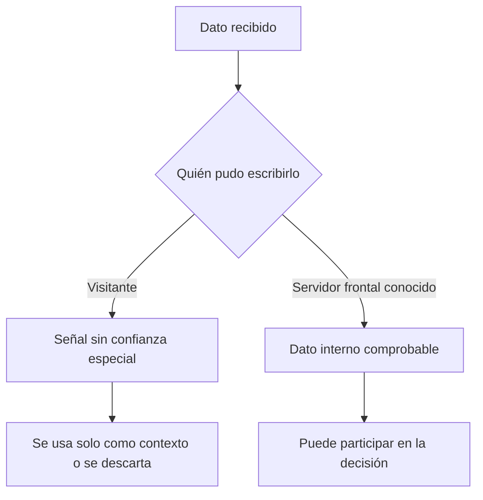

# Cómo están conectadas las piezas

AbuseShield se coloca delante de la aplicación que quieres proteger. Recibe una
solicitud, reúne las señales disponibles y decide si puede continuar, si conviene
observarla, pedir una comprobación o rechazarla

## La única entrada pública

El visitante debe llegar primero a AbuseShield. La aplicación puede conservar
una dirección interna, pero no otra dirección pública que permita saltarse la
revisión

Esto es importante incluso con una configuración perfecta. Si Internet también
puede llegar directamente al origen, una persona automatizada elegirá ese camino

## Lo que puede creer

Una cabecera HTTP enviada por el visitante no se vuelve confiable por tener un
nombre técnico. Datos como la dirección original, la huella de la conexión o la
cuenta deben venir de una frontera conocida y protegida

## Lo que ocurre dentro

La decisión final vive hoy en PHP. Go y Rust ya pueden asumir una parte concreta
del análisis de rutas repetidas cuando se activa su dueño en la memoria
compartida. Si esa parte deja de responder, la cobertura se muestra como
incompleta; no se vuelve a calcular en PHP a escondidas. La migración del
recorrido completo sigue pendiente. Para entender una decisión, mira la acción,
su alcance, los motivos y si faltó alguna dependencia

Redis mantiene memoria compartida entre procesos. Si deja de responder, el
sistema muestra la degradación y limita lo que puede afirmar. La memoria temporal
de un proceso no reemplaza silenciosamente el estado compartido cuando Redis vuelve

## Paneles y análisis

La consola ayuda a revisar decisiones. Grafana muestra evolución y dependencias
La retención adicional permite relacionar actividad durante más tiempo

Ninguno de esos paneles debe ser una condición oculta para proteger una solicitud
Si un panel cae, la protección informa la pérdida de visibilidad sin convertir al
visitante en culpable

## Qué debes demostrar al conectarlo

- la aplicación solo recibe operaciones que AbuseShield dejó continuar
- una comprobación o un rechazo no ejecutan la operación protegida
- el origen no conserva una entrada pública alternativa
- los datos internos no pueden ser inventados desde Internet
- una dependencia caída aparece como degradación visible
- cada decisión puede localizarse con su identificador

El contrato exacto está en [Arquitectura e invariantes](../architecture.md)
