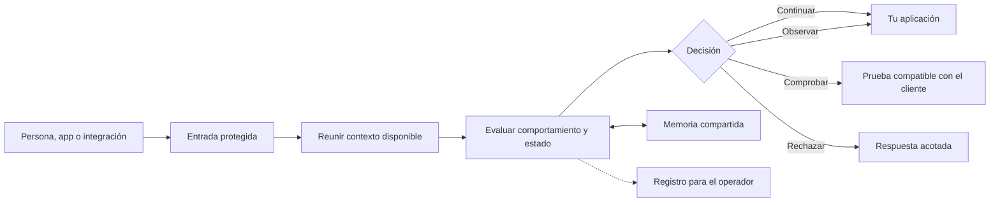
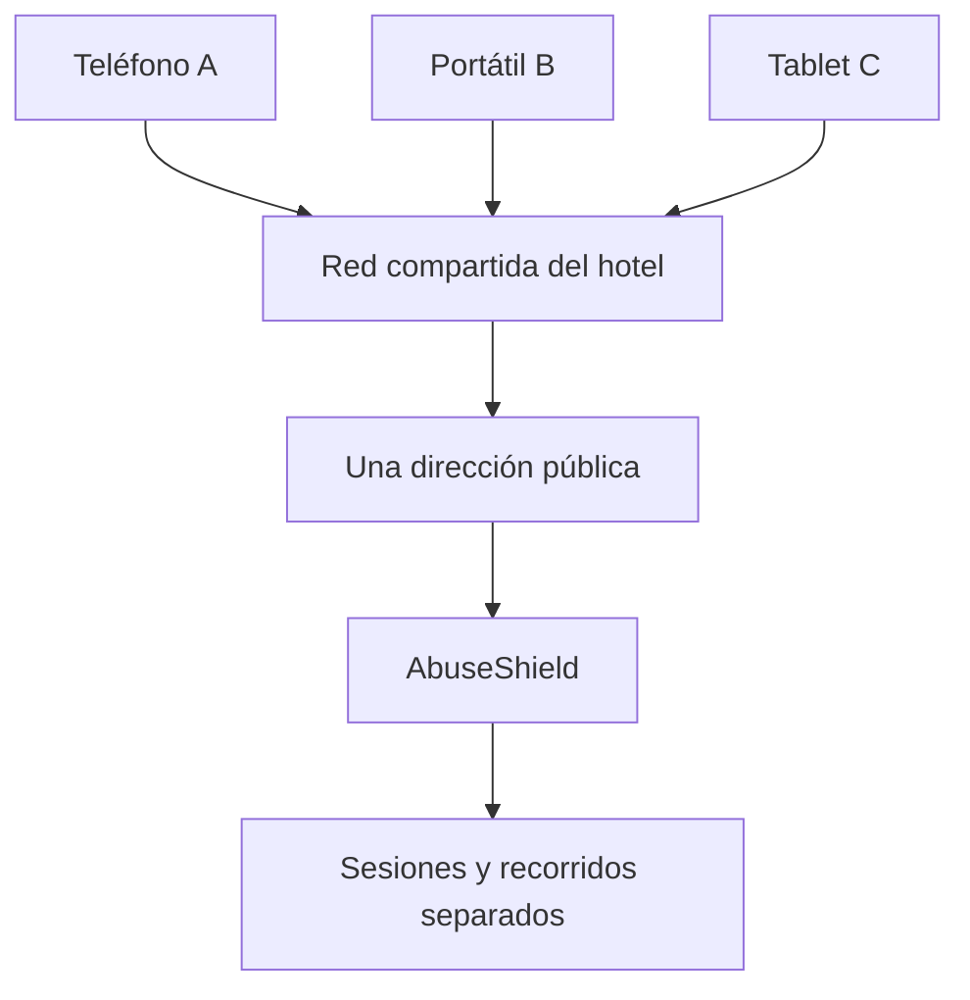

# Cómo funciona AbuseShield

AbuseShield se coloca antes de tu aplicación. Cada vez que alguien abre una
página, inicia sesión, usa una API o envía un pago, revisa esa solicitud y decide
si puede continuar, si necesita una comprobación o si debe detenerse.

No intenta reconocer a una persona por una única señal. Observa la evolución de
la sesión, la ruta solicitada, los reintentos, la coherencia del cliente y el
estado del propio sistema. Una VPN, una dirección compartida o un navegador poco
común pueden explicar una rareza, pero no bastan para condenar una solicitud.

## El recorrido de una solicitud

La entrada protegida elimina datos internos que un visitante podría falsificar
y añade solo lo que realmente observó. Si tu aplicación sigue accesible por otro
puerto o dominio, esa entrada alternativa evita AbuseShield.

## Las cuatro respuestas

Fuente canónica: [Canon de decisiones](../reference/decision-canon.md)
(`retry` es resultado operacional, no quinta decisión).

| Respuesta | Qué vive la persona o el cliente | Qué revisa el operador |
|---|---|---|
| `allow` | La solicitud continúa | No apareció presión suficiente para intervenir |
| `observe` | Continúa sin una prueba adicional | Hay señales que conviene conservar y comparar |
| `challenge` | Debe completar una comprobación o reintentar | La evidencia justifica fricción reversible |
| `block` | La solicitud no continúa | Existe evidencia suficiente y un alcance definido |

`degraded` y `quarantine` no describen al visitante. Describen el estado del
servicio o de uno de sus módulos. Una dependencia caída debe verse como capacidad
reducida, no como una persona culpable ni como riesgo cero.

## Qué observa sin convertirlo en una sentencia

AbuseShield puede comparar velocidad, rutas, secuencias, reintentos, forma de
los datos y coherencia técnica. Cada grupo responde una pregunta distinta:

- ¿La actividad cambia a un ritmo razonable o repite un patrón rígido?
- ¿Las rutas forman un recorrido coherente con lo que el cliente parece hacer?
- ¿Los objetivos cambian de forma natural o se enumeran uno detrás de otro?
- ¿El mismo intento reaparece de manera incompatible con un error normal?
- ¿El cliente tiene capacidad para resolver la comprobación propuesta?

Una señal repetida con nombres distintos no se convierte en varias pruebas
independientes. El bloqueo debe conservar qué evidencia lo autorizó y sobre qué
identidad vinculada, ruta, operación o período actúa.

## Un hotel no es una sola persona

Muchas personas pueden salir a Internet con la misma dirección pública. Pasa en
hoteles, oficinas, universidades, hogares y redes móviles. AbuseShield trata esa
dirección como contexto de red, no como identidad humana.

Si una sesión enumera cuentas y otra compra normalmente, compartir red no debe
mezclarlas. Cuando faltan señales para separarlas, la respuesta prudente es
reducir confianza o pedir una comprobación acotada, no bloquear todo el hotel.

## Qué pasa cuando algo interno falla

Redis permite que varios procesos compartan contadores, consumos únicos y
estado reciente. Si deja de responder, AbuseShield lo declara y pierde parte de
esa coordinación. La memoria de un proceso puede sostener una respuesta acotada,
pero no fingir que todos los procesos conocen lo mismo.

La misma regla aplica a telemetría, análisis adicional y verificadores móviles:
la capacidad ausente queda visible, y una señal que no pudo comprobarse no se
convierte automáticamente en válida o inválida.

## Lo que debes conectar tú

Levantar los contenedores no descubre tu aplicación. Debes decidir qué rutas
pasan por AbuseShield y cerrar cualquier camino público alternativo al origen.
Empieza con [tu primera hora](primera-hora.md), luego elige la integración
[web](../integrations/web.md), [Laravel](../integrations/laravel.md),
[Android](../integrations/android.md), [iOS](../integrations/ios.md) o
[WebView/API](../integrations/webview-api.md).

Para revisar invariantes, autoridad y fallos exactos, usa la
[arquitectura técnica](../architecture.md).
