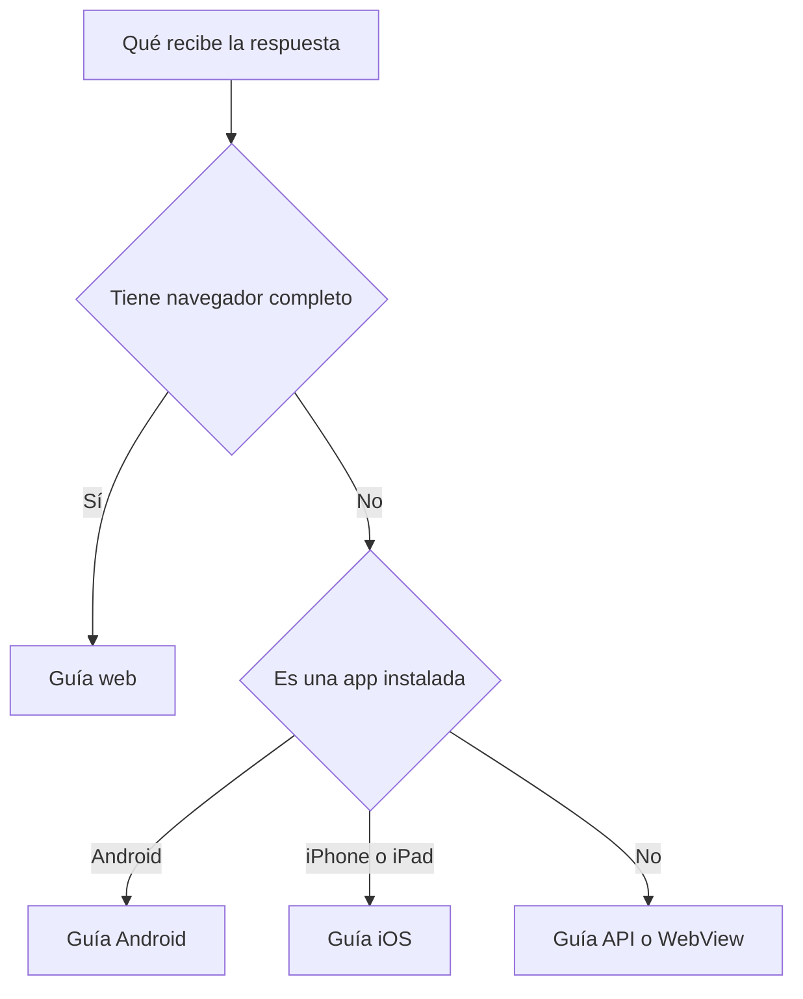
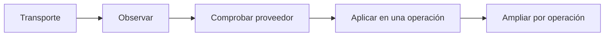

# Conectar una aplicación

Elige una sola guía según el cliente que hace la solicitud. Una web, una API y
una app móvil pueden llegar a la misma operación, pero no disponen de las mismas
cookies, almacenamiento ni comprobaciones del dispositivo

## Elegir el recorrido

| Lo que tienes | Empieza aquí | Lo que queda conectado |
|---|---|---|
| Sitio web o aplicación Laravel | [Web y navegador](web.md) | Entrada pública, aplicación privada y respuesta para navegador |
| API, webhook, tarea o WebView | [API y clientes limitados](api-webview.md) | Respuesta estructurada, reintentos y capacidad declarada |
| App Android | [Android](android.md) | Protocolo móvil v2 y Play Integrity |
| App iPhone o iPad | [iOS](ios.md) | Protocolo móvil v2 y App Attest |

No conectes una app móvil siguiendo la guía de navegador. Tampoco envíes una
pantalla HTML a un webhook o a una API que no puede mostrarla



## Lo que comparten todas las integraciones

1. AbuseShield debe estar levantado y sano
2. La solicitud debe pasar por su entrada antes de llegar a tu aplicación
3. Tu autenticación sigue siendo obligatoria
4. `allow` y `observe` dejan continuar la operación
5. `challenge` y `block` impiden que la operación protegida se ejecute
6. La respuesta conserva un identificador de correlación para poder revisarla
7. El origen no puede mantener otra dirección pública que evite la protección

Comprueba primero el recorrido sin modificar sensibilidad

```bash
./abuseshield status operations
./abuseshield integrate web --check
./abuseshield integrate api --check
./abuseshield integrate android --check
./abuseshield integrate ios --check
```

Ejecuta solo el comando correspondiente a tu cliente. En Android e iOS,
`incompleto` puede significar que el servidor está preparado pero todavía faltan
credenciales, la lista firmada de apps permitidas o código dentro de la app

## Orden de activación



- **Transporte** confirma que app, entrada y origen intercambian la misma solicitud
- **Observar** registra el resultado sin convertir una ausencia en bloqueo
- **Comprobar proveedor** valida Play Integrity o App Attest cuando corresponda
- **Aplicar** empieza por una sola operación sensible y conserva vuelta atrás
- **Ampliar** ocurre después de revisar personas legítimas y fallos del proveedor

## Cuándo puedes cerrar la integración

La parte de servidor queda conectada cuando puedes repetir estas comprobaciones:

- una solicitud de la aplicación aparece en el panel con su ruta y hora
- una intervención evita que el controlador u origen ejecute la operación
- Redis caído aparece como dependencia perdida y no como culpabilidad del cliente
- una solicitud repetida conserva límites de reintento
- la correlación permite encontrar la misma solicitud de extremo a extremo
- no hay un puerto o dominio público alternativo hacia el origen

Android e iOS tienen un cierre adicional. Necesitan una build real, credenciales
del proveedor y un dispositivo físico. Las pruebas del repositorio comprueban el
contrato del servidor, no sustituyen esa evidencia

## Referencia separada

Las guías anteriores explican el recorrido completo. Los formatos exactos,
cabeceras y validaciones internas están agrupados en la
[referencia técnica de integraciones](../integrations/README.md)
