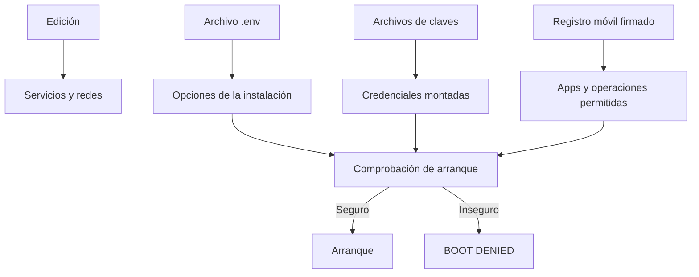

# Configurar sin perder el camino

La configuración decide qué servicios arrancan, qué datos son confiables y qué
acciones puede tomar AbuseShield. Empieza con una edición y cambia una sola causa
por vez

## Dónde vive cada cosa



| Necesitas cambiar | Empieza aquí |
|---|---|
| Servicios que se levantan | [Elegir una edición](ediciones.md) |
| Claves y acceso al panel | [Claves y acceso](claves.md) |
| Puertos y varias instalaciones | [Instalar en un servidor](servidor.md) |
| Web, API o app móvil | [Conectar tu aplicación](conectar-aplicacion.md) |
| Una actualización o rotación | [Cambios y recuperación](cambios.md) |

## Primer arranque

Puedes dejar que la edición cree claves persistentes o ejecutar primero:

```bash
./abuseshield setup core
./abuseshield config core
./abuseshield up core
```

`setup` no inicia contenedores. Prepara el archivo local, genera valores fuertes
y rechaza una combinación insegura antes de reemplazar la configuración existente

## Cambios seguros

1. Guarda la revisión, edición y configuración actuales sin copiar secretos a Git
2. Cambia una opción y revisa la configuración resultante
3. Ejecuta el diagnóstico de la edición
4. Prueba una solicitud normal y el caso que motivó el cambio
5. Conserva una forma comprobada de volver atrás

No uses una variable desconocida esperando que el sistema la interprete. Tampoco
dupliques una clave con valores distintos en el archivo local y el almacenamiento
persistente

## Cuando el arranque se niega

Lee el código de error, la causa, el riesgo y la corrección. Cambia el valor
indicado y repite el mismo comando

No conviertas el error en una advertencia ni desactives la comprobación en
producción. El rechazo existe porque esa combinación rompe una garantía concreta

La lista exacta de opciones, tipos y valores está en [Configuración](../configuration.md)
