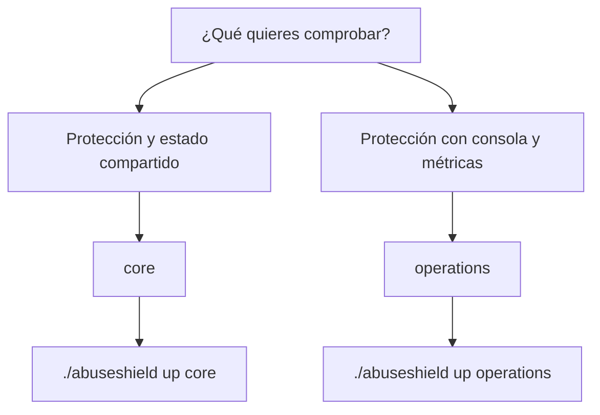
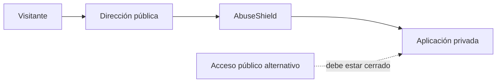

# Tu primera hora con AbuseShield

Este recorrido termina con una edición levantada, una solicitud comprobada y
una forma clara de detenerla sin borrar estado. Usa `core` para aprender el
flujo mínimo; elige `operations` si también quieres abrir la consola.

## Antes de empezar

Necesitas la copia completa del repositorio, Docker Engine y Compose `2.24.4` o
posterior. Confirma que Docker responde:

```bash
docker compose version
docker info
```

Si el segundo comando falla, todavía no hay un problema de AbuseShield. Resuelve
el servicio de Docker o el acceso de tu usuario con [Resolver problemas](problemas.md).

## 1. Elige un recorrido



No necesitas elegir todas las funciones el primer día. Las ediciones mayores
añaden servicios y operación; no corrigen una integración incompleta.

## 2. Arranca y espera la comprobación

Desde la raíz del repositorio:

```bash
./abuseshield up core
./abuseshield status core
```

El primer comando construye lo que falte, genera claves persistentes, espera las
comprobaciones de salud y ejecuta el diagnóstico. El segundo permite repetir esa
revisión.

También puedes usar Compose directamente desde `deploy/editions/core`:

```bash
docker compose up --build --detach --wait --wait-timeout 900
docker compose ps --all
```

Ese camino levanta la misma edición y conserva el nombre de proyecto definido
por ella. No ejecuta todas las comprobaciones del CLI; vuelve a la raíz y usa
`./abuseshield doctor core` antes de considerar cerrado el arranque.

## 3. Comprueba la entrada

```bash
curl -i http://127.0.0.1:8080/
curl -k -i https://127.0.0.1:8443/
```

Lee tres cosas:

1. Hubo una respuesta HTTP; una conexión rechazada o un timeout es un fallo de despliegue
2. `X-AbuseShield-Action` muestra la acción pública cuando corresponde
3. `X-Correlation-ID` permite localizar la misma solicitud sin compartir secretos

Un `403` puede ser una decisión válida. Un `502` indica que la entrada no pudo
hablar correctamente con la aplicación o uno de sus servicios.

## 4. Abre la consola si elegiste operations

```bash
./abuseshield access operations
```

Para mostrar la clave en una terminal privada:

```bash
./abuseshield access operations --show-secrets
```

La consola está en `http://127.0.0.1:8080/abuseshield/admin` y Grafana en
`http://127.0.0.1:3001`. `core` responde `404` en la ruta administrativa porque
esa superficie no forma parte de la edición.

## 5. Distingue “levantado” de “integrado”

Al terminar esta guía, AbuseShield responde. Todavía debes demostrar que el
tráfico de tu aplicación atraviesa esa entrada y que el origen no acepta una
ruta pública alternativa.



Sigue [Conectar tu aplicación](conectar-aplicacion.md). Allí se separan web,
Laravel, API, Android e iOS sin declarar un cliente como navegador para forzar
una comprobación distinta.

## 6. Detén sin borrar

```bash
./abuseshield down core
```

Los volúmenes permanecen. El siguiente arranque reutiliza claves y estado. Usa
`--volumes` solo cuando quieras borrar deliberadamente los datos de esa edición.

## Tu resultado al cerrar

Puedes dar esta primera hora por terminada cuando:

- `status` o `doctor` aprueban la edición elegida
- HTTP y HTTPS responden desde la propia máquina
- sabes distinguir una decisión `403` de una conexión rota
- conoces el identificador que permite investigar una solicitud
- puedes detener y volver a levantar sin regenerar claves

Sigue con [Elegir una edición](ediciones.md), [Claves y acceso](claves.md) o
[Instalar en un servidor](servidor.md), según tu próximo paso.
