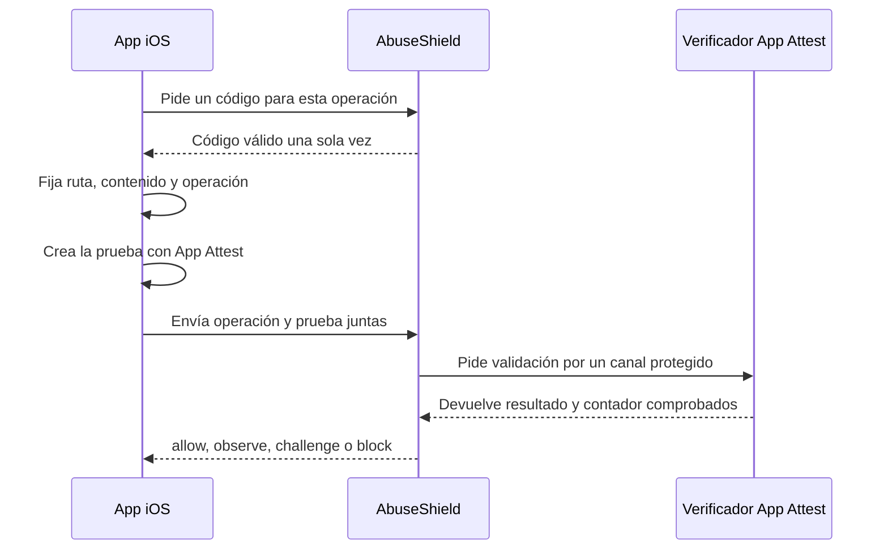

# Conectar una app iOS

Esta guía une una operación de iPhone o iPad con App Attest y con la decisión del
servidor. AbuseShield emite un código de un solo uso, evita reutilizaciones y
protege el canal hacia el servicio que comprueba App Attest. Tu instalación
todavía debe operar ese verificador y añadir el cliente Swift

## Estado de esta integración

El adaptador servidor y su contrato autenticado están implementados. Este
repositorio no incluye una biblioteca Swift ni un verificador App Attest
completo. Ambos forman parte de la instalación hasta que existan componentes
distribuibles y validados por separado

## Qué necesitas

- App ID registrado en Apple Developer
- capacidad App Attest habilitada para la app
- bundle ID exacto de la build
- entorno App Attest correcto para desarrollo o distribución
- verificador servidor que valide attestation, assertion y contador
- secreto distinto para autenticar AbuseShield con ese verificador
- una edición de AbuseShield y Redis sano

App Attest no funciona como una clave pegada en un `.env`. La app crea una clave
en el dispositivo, Apple certifica esa clave y tu verificador conserva la clave
pública y el contador

## Quién hace cada parte

| Parte | Responsabilidad |
|---|---|
| Quien opera AbuseShield | Registra la app y protege el canal con el verificador |
| Quien desarrolla iOS | Gestiona la clave del dispositivo y genera las pruebas |
| Apple | Certifica la clave creada por la app |
| Verificador privado | Comprueba certificados, firma, contexto y contador |
| AbuseShield | Une ese resultado con la operación y aplica la política |

## Flujo completo



## 1. Preparar AbuseShield

```bash
./abuseshield setup operations
./abuseshield integrate ios --check
```

Copia la lista de ejemplo a una ubicación privada y deja únicamente tu bundle
ID, operaciones, métodos y rutas. Genera la clave de firma fuera de la carpeta
del proyecto

```bash
cp docs/integrations/mobile-registry.unsigned.example.json /ruta/privada/mobile-registry.json
php scripts/mobile-registry.php keygen \
  --key-ref ios-registry-2026 \
  --private /ruta/privada/mobile-registry.key \
  --keyring deploy/mobile-config/keyring.json
php scripts/mobile-registry.php sign \
  --registry /ruta/privada/mobile-registry.json \
  --private /ruta/privada/mobile-registry.key \
  --output deploy/mobile-config/mobile-registry.signed.json
php scripts/mobile-registry.php verify \
  --registry deploy/mobile-config/mobile-registry.signed.json \
  --keyring deploy/mobile-config/keyring.json
```

Genera un secreto aleatorio para el canal con el verificador y guárdalo en:

```text
deploy/mobile-secrets/apple-attest-signing-secret
```

El mismo secreto debe llegar al verificador por su sistema de secretos. No lo
copies al proyecto Xcode ni al registro móvil

## 2. Activar solo observación

En el `.env` de la edición:

```dotenv
ABUSE_SHIELD_MOBILE_INTEGRITY=true
ABUSE_SHIELD_MOBILE_REQUIRE_SHARED_STATE=true
ABUSE_SHIELD_MOBILE_REGISTRY_MODE=shadow
ABUSE_SHIELD_MOBILE_REGISTRY_PATH=/run/abuseshield-mobile/mobile-registry.signed.json
ABUSE_SHIELD_MOBILE_REGISTRY_KEYRING_PATH=/run/abuseshield-mobile/keyring.json
ABUSE_SHIELD_MOBILE_PROVIDERS=apple_app_attest
ABUSE_SHIELD_APPLE_ATTEST_VERIFIER_URL=https://verifier.internal.example/v1/verify
ABUSE_SHIELD_APPLE_ATTEST_SIGNING_SECRET_PATH=/run/abuseshield-mobile-secrets/apple-attest-signing-secret
```

```bash
./abuseshield up operations
./abuseshield status operations
./abuseshield integrate ios --check
```

Producción exige HTTPS para el verificador. La excepción HTTP local funciona
solo en entorno local o testing, con debug activo y destino loopback

`shadow` significa que la comprobación se ejecuta y deja evidencia, pero todavía
no endurece la decisión para una persona

## 3. Añadir App Attest a la app

Usa `DCAppAttestService.shared` y comprueba `isSupported` antes de pedir una
clave. Un dispositivo sin soporte sigue necesitando una ruta válida de acceso;
la ausencia reduce evidencia, no demuestra ataque

Para una instalación nueva:

1. pide `generateKey()` y guarda el `keyId` en almacenamiento persistente
2. pide un código de un solo uso para la operación de registro
3. calcula los 32 bytes de `clientDataHash` a partir de la huella v2 (`binding`)
4. llama `attestKey(_:clientDataHash:)`
5. envía attestation, key ID y request original
6. conserva en el verificador la clave pública validada y su contador

Para operaciones posteriores:

1. construye método, destino y contenido definitivos
2. pide un código nuevo
3. calcula la huella y `clientDataHash`
4. llama `generateAssertion(_:clientDataHash:)`
5. envía assertion y key ID en el sobre v2

`clientDataHash` son los 32 bytes obtenidos al decodificar el hexadecimal del
binding. No entregues los 64 caracteres ASCII y no apliques SHA-256 otra vez

## 4. Responsabilidad del verificador

El verificador debe comprobar el formato firmado de Apple, la cadena de
certificados, el código de un solo uso, App ID, entorno, clave pública y contador.
La [referencia técnica](../integrations/ios.md#contrato-del-verificador) conserva
los campos y formatos exactos. Además debe:

- verificar la firma HMAC de la solicitud antes de procesar la prueba
- limitar tamaño, tiempo y frecuencia
- persistir la clave pública después de la primera attestation
- exigir avance válido del contador en assertions
- devolver firmados todos los campos que ligan la prueba a la operación
- distinguir proof inválido de timeout o indisponibilidad temporal

Una respuesta firmada no basta. `app_integrity` debe estar verificado y el estado
del contador debe ser aceptable

## 5. Probar una operación

| Caso | Resultado esperado |
|---|---|
| Primera instalación legítima | Attestation aceptada y clave pública guardada |
| Assertion posterior | Firma válida y contador avanzado |
| Prueba repetida | Reutilización o contador inválido |
| App reinstalada | Nuevo ciclo de clave, no bloqueo permanente automático |
| Código vencido tras volver a la app | Nueva comprobación acotada |
| Cambio Wi-Fi a datos | El cambio de red no invalida por sí solo la app |
| Verificador responde `429` o `5xx` | Reintento con espera y estado visible |
| Dispositivo sin soporte | Ruta limitada o alternativa definida por la política |

Prueba desarrollo, TestFlight y la distribución prevista. Apple indica que las
builds distribuidas operan en producción aunque el entitlement usado durante el
desarrollo sea distinto

## 6. Pasar de observar a aplicar

Mantén solo observación (`shadow`) mientras compares dispositivos, reinstalaciones, versiones de
iOS, background y caídas del verificador. Promueve una sola operación y conserva
una vuelta inmediata a `shadow`

No bloquees una cuenta solo porque se generó una clave nueva. Las claves no
sobreviven reinstalación, migración ni restauración desde backup

## Diagnóstico

| Síntoma | Revisa primero |
|---|---|
| `isSupported` es falso | Dispositivo, extensión y política alternativa |
| Attestation inválida | Entorno, App ID prefix, bundle ID y challenge |
| Assertion inválida | Key ID, bytes de `clientDataHash` y contador |
| Funciona en debug y falla en TestFlight | Entitlement y entorno de App Attest |
| `503` | URL, TLS, secreto o salud del verificador |
| Binding distinto | Método, query o body cambió después de calcularlo |

## Cierre

- la lista y sus claves públicas verifican la firma
- secreto y claves privadas no aparecen en la app, Git ni logs
- attestation inicial se valida en iPhone o iPad físico
- assertions posteriores avanzan el contador
- reutilización, cambio de contenido y cambio de operación se rechazan
- reinstalación y dispositivo sin soporte tienen conducta definida
- caída del verificador es visible y recuperable
- la integración puede volver a `shadow` sin publicar otra build

Hasta completar todos los puntos, conserva `shadow`. Las pruebas automatizadas
cierran el adaptador y el protocolo, no la validación de Apple en hardware

Los mensajes HMAC, campos y respuestas están en la
[referencia técnica de iOS](../integrations/README.md#ios)

Fuentes del proveedor: [App Attest](https://developer.apple.com/documentation/devicecheck/dcappattestservice),
[integración en la app](https://developer.apple.com/documentation/devicecheck/establishing-your-app-s-integrity)
y [validación servidor](https://developer.apple.com/documentation/devicecheck/validating-apps-that-connect-to-your-server)
