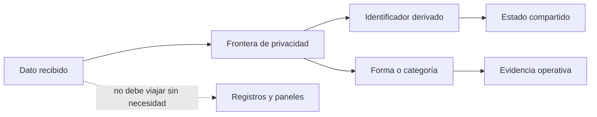

# Privacidad y datos

AbuseShield necesita recordar actividad reciente sin convertir los registros en
una copia de la identidad del visitante. La regla práctica es guardar lo mínimo
que permita explicar y relacionar una decisión

## Antes y después de la frontera

Una dirección IP, una cookie o una cabecera pueden ser necesarias mientras se
procesa la solicitud. Eso no significa que deban aparecer sin transformar en
Redis, telemetría, paneles o informes

## Identificadores derivados

El sistema usa claves secretas y separación por propósito para producir
referencias que no revelen directamente el valor original. La misma entrada no
debe mezclarse entre cuentas o usos diferentes por accidente

Cambiar una clave de privacidad modifica esas referencias. No es una edición
cosmética del archivo de configuración. Antes de rotarla hay que decidir qué
ocurre con el estado creado por la clave anterior

## Lo que no debes compartir

- archivos `.env` y claves montadas en el servidor
- cookies o cabeceras de autorización
- objetos completos de Play Integrity o App Attest
- cuerpos con credenciales, pagos o datos personales
- direcciones IP crudas en capturas o casos públicos
- mensajes de proveedor que puedan contener material sensible

## Qué enviar en un caso de soporte

Incluye la hora, edición, revisión del código, ruta sin datos personales, acción,
tipo de cliente e identificador de correlación. Si una captura contiene un dato
crudo, ocúltalo antes de compartirla

## Retención

Cada edición conserva cantidades distintas de contexto. Define cuánto tiempo
necesitas investigar un caso y elimina copias derivadas cuando termina ese plazo
La política debe cubrir Redis, almacenamiento histórico, archivos de evidencia y
copias de seguridad, no solo el panel visible

Para revisar los límites exactos usa [Configuración](../configuration.md) y el
[modelo de amenazas](../architecture.md)
