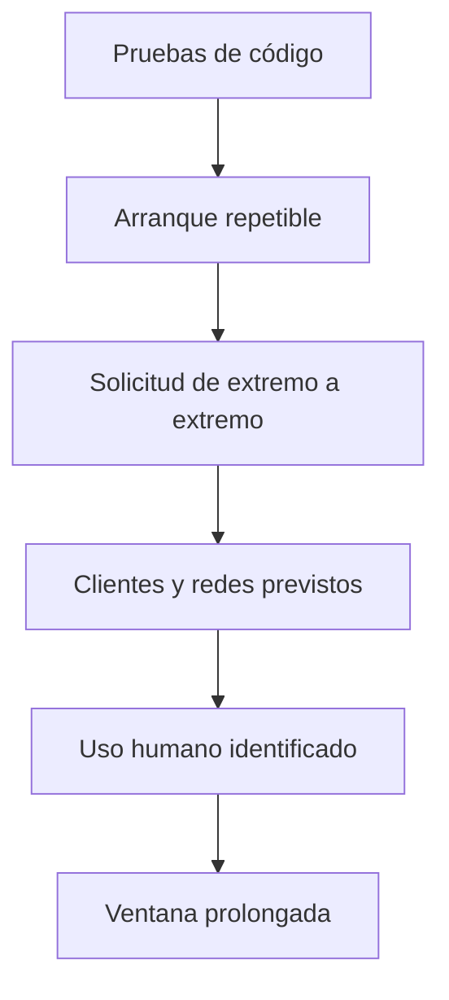

# Probar una integración

Una prueba debe decir qué ocurrió y qué todavía no demuestra. Que una ruta
responda no confirma que Android, iOS, Redis o una persona real se comporten como
esperas

## Capas de evidencia

| Capa | Qué demuestra | Qué deja abierto |
|---|---|---|
| Pruebas de código | Contratos y casos conocidos | Servicios reales y red |
| Arranque de edición | Contenedores, claves y comprobaciones | Integración con tu aplicación |
| Recorrido completo | Entrada, decisión y origen | Diversidad de clientes |
| Matriz de clientes | Navegadores, API, WebView y móvil previstos | Conducta humana prolongada |
| Ventana humana | Fricción y omisiones observadas | Otros entornos y cambios futuros |

## Recorrido mínimo

1. Registra la revisión del código y la edición
2. Ejecuta `./abuseshield status <edición>`
3. Envía una solicitud normal a través de la entrada pública prevista
4. Confirma que la aplicación ejecutó la operación una sola vez
5. Provoca una intervención autorizada y confirma que el origen no se ejecutó
6. Localiza ambas solicitudes con su identificador
7. Reinicia la dependencia elegida y comprueba degradación y recuperación

## Clientes que no debes mezclar

- navegador de escritorio
- navegador móvil
- WebView o navegador integrado
- API o webhook
- app Android nativa
- app iOS nativa
- cliente sin JavaScript o sin cookies

Una prueba de navegador no cierra una integración móvil. Una petición hecha con
`curl` no demuestra Play Integrity ni App Attest

## Redes y personas legítimas

Incluye redes compartidas, VPN, bloqueadores, conexiones lentas, cambios entre
Wi-Fi y datos, sesiones largas y errores normales de una persona. Etiqueta esos
casos antes de mirar el resultado para no convertir una suposición en evidencia

## Laboratorio

Usa solo infraestructura propia o autorizada. Separa los resultados del
laboratorio y del uso humano. Un generador de tráfico sirve para reproducir una
condición, pero no reemplaza la conducta de una persona

Continúa con [Compatibilidad de clientes](../compatibility.md) o el
[laboratorio local acotado](../deployments.md)
