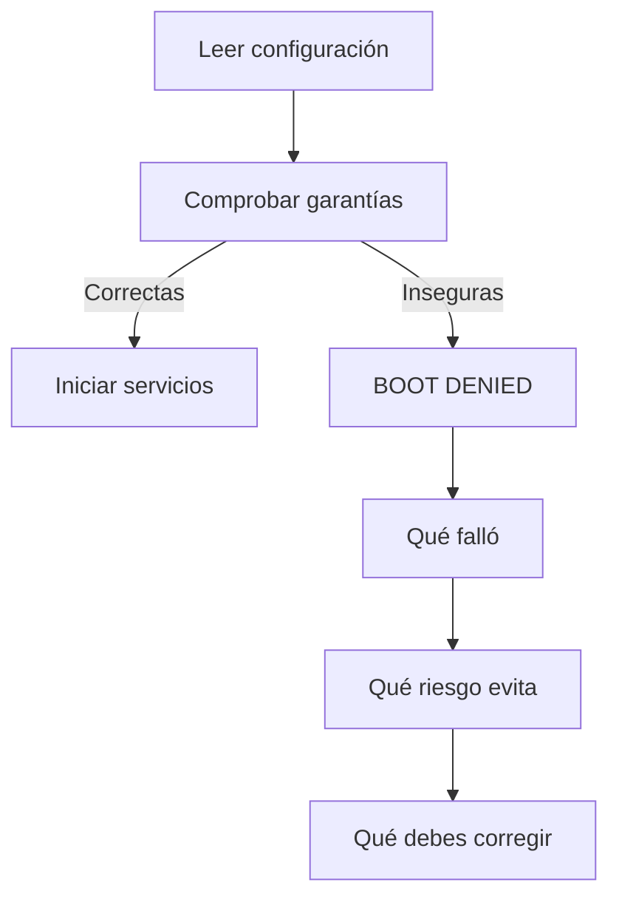

# Mantener una instalación segura

La instalación debe rechazar estados que no puede defender. Un aviso perdido en
los registros no alcanza cuando una clave débil o una frontera mal configurada
pueden cambiar la identidad de quien envía una solicitud

## Antes de aceptar tráfico

El arranque debe detenerse ante claves de ejemplo, consola sin protección,
depuración cruda, métricas públicas no autorizadas, umbrales contradictorios o
confianza en intermediarios que no fueron declarados

## Claves

El primer arranque puede generar claves distintas para la instalación. No uses
la misma clave para privacidad, consola, base de datos y comunicación interna

Guárdalas fuera de Git, limita quién puede leerlas y prepara una rotación antes
de necesitarla. Cambiar un valor sin considerar el estado existente puede dejar
procesos que ya no reconocen los mismos datos

## Red

- publica solo la entrada necesaria para el tráfico
- conserva la consola y los paneles en una red privada o un acceso autenticado
- no publiques PHP-FPM, Redis, bases de datos ni servicios de análisis
- declara los servidores intermediarios exactos que pueden aportar datos internos
- evita rangos que confían en cualquier dirección de Internet

## Actualizaciones

Una actualización incluye código, imágenes, configuración y estado. Guarda la
combinación conocida antes de cambiar y prueba cómo volver a ella

No cambies sensibilidad y versión en la misma ventana. Si algo empeora, necesitas
saber cuál de las dos decisiones lo causó

## Si algo falla

Conserva el mensaje completo sin secretos, detén la ampliación del cambio y vuelve
a la combinación conocida cuando no puedas sostener la garantía. No desactives la
comprobación de producción para conseguir que el servicio arranque

Continúa con [Claves y acceso](claves.md), [Cambios y recuperación](cambios.md) o
[Resolver problemas](problemas.md)
