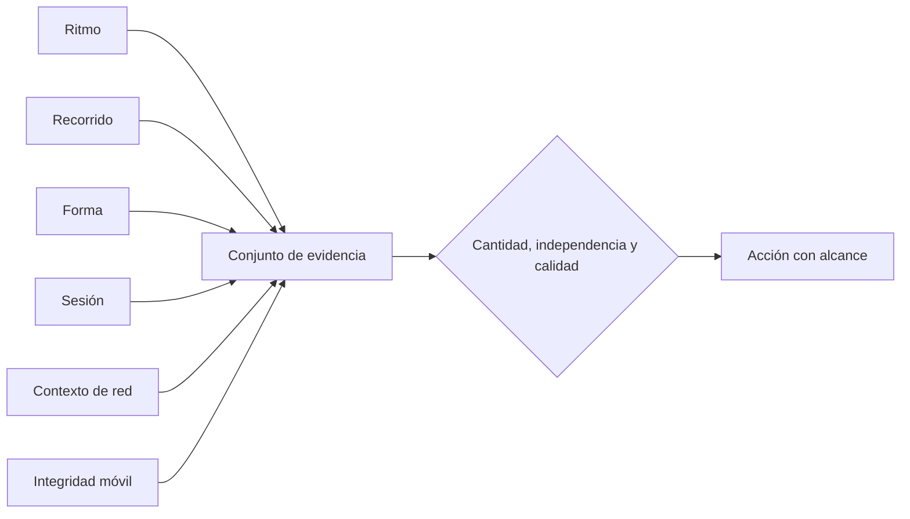

# Qué observa y qué no puede concluir

AbuseShield no decide por una etiqueta como “VPN”, “móvil” o “Firefox”. Reúne
observaciones diferentes y comprueba si cuentan una historia coherente

## Familias de señales

| Observación | Qué puede aportar | Qué no demuestra por sí sola |
|---|---|---|
| Ritmo y repeticiones | Automatización regular, ráfagas o reintentos extraños | Que toda actividad rápida sea un bot |
| Recorrido entre rutas | Enumeración, secuencias repetidas o cambios sin intención clara | Que una ruta poco común sea maliciosa |
| Forma de la solicitud | Reutilización, cargas anómalas o entradas incompatibles | La identidad de una persona |
| Sesión y continuidad | Si la conducta evoluciona o se reinicia para evadir límites | Que una sesión larga sea confiable |
| Red compartida | Contexto de hotel, oficina, operador móvil o intermediario | Que una dirección represente a una sola persona |
| Conexión cifrada | Coherencia técnica cuando esa señal llega desde una frontera válida | Que una huella identifique a alguien |
| Integridad móvil | Si el proveedor pudo verificar la app y la operación | Que toda persona con un teléfono válido sea legítima |

## Varias señales no siempre son varias pruebas

Dos motores pueden mirar la misma observación. Que ambos reaccionen no convierte
una única causa en dos pruebas independientes

Por eso una decisión fuerte necesita revisar el origen de la evidencia, no solo
sumar puntuaciones. Una red compartida, un navegador limitado y una huella que
cambió pueden describir el mismo contexto legítimo

## Cuando faltan datos

Una app nativa, un webhook y un navegador no entregan las mismas señales. La
ausencia esperada reduce lo que el sistema puede afirmar. No se rellena con una
puntuación inventada ni se castiga por no parecer un navegador

## Señales que merecen cuidado adicional

- horarios regulares también aparecen en tareas legítimas y notificaciones
- muchas personas pueden compartir una dirección pública
- un cambio de Wi-Fi a datos móviles puede ocurrir durante una operación
- bloqueadores y protecciones de privacidad eliminan información del navegador
- una app instalada miles de veces puede producir conexiones casi idénticas
- una API bien escrita puede ser más regular que un bot mal hecho

## Cómo revisar una decisión

1. Identifica la acción y su alcance
2. Revisa qué observaciones fueron realmente independientes
3. Comprueba qué datos faltaban o estaban degradados
4. Compara con solicitudes legítimas de la misma ruta y tipo de cliente
5. Ajusta la causa concreta antes de cambiar una regla global

La lista exacta de motores y sus contratos está en [Motores](../engines.md)
