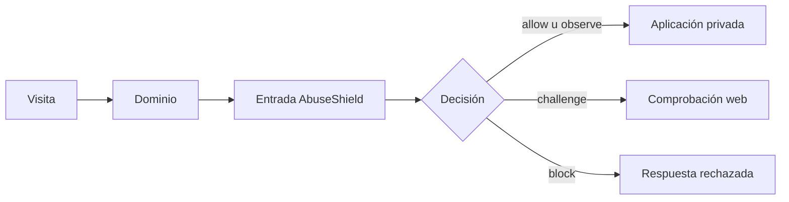

# Conectar una web

Esta guía termina con una visita que entra por AbuseShield, recibe una decisión
y solo después llega a tu aplicación

## Antes de empezar

Necesitas el dominio o dirección de prueba, la ubicación interna de tu
aplicación y una edición de AbuseShield levantada

```bash
./abuseshield up operations
./abuseshield status operations
./abuseshield integrate web --check
```

`status` debe terminar con `ready: true`. Si no ocurre, corrige el arranque antes
de cambiar DNS, proxy o rutas

## Elegir cómo se conecta

| Aplicación | Integración |
|---|---|
| Laravel | Instala el paquete y aplica el middleware a rutas explícitas |
| Otro framework PHP | Ejecuta `WafKernel` en el punto de entrada |
| Node, Go, Java, Python u otro lenguaje | Implementa la evaluación de preflight y el reenvío al origen privado; no hay un conector automático |



## Laravel

Fija una revisión del paquete en `composer.lock`, publica la configuración y
aplica el alias `abuseshield` solo donde hayas decidido proteger

```bash
php artisan vendor:publish --tag=abuseshield-config
php artisan vendor:publish --tag=abuseshield-migrations
php artisan migrate
php artisan abuseshield:status
```

```php
Route::middleware(['abuseshield'])->group(function (): void {
    Route::post('/login', LoginController::class);
    Route::post('/checkout', CheckoutController::class);
});
```

Incluye una prueba de aplicación que falle si una ruta sensible pierde el
middleware. Health checks, archivos públicos y callbacks con autenticación propia
deben quedar fuera solo cuando la exclusión sea intencional

## Aplicación detrás de Nginx

El filtro previo incluido usa `EdgePreflightGuard` y entrega las solicitudes al
PHP del proyecto. `WafKernel::preflight()` es otra integración, que ejecuta la
evaluación completa. Para un backend externo hay que configurar ambos extremos
y conservar los bytes de la solicitud y las respuestas de intervención.
Consulta el [contrato de integración web](../integrations/web.md) para elegir
el recorrido antes de publicar.

Mantén publicado únicamente el puerto de la entrada. PHP-FPM, Redis y el origen
deben permanecer en una red privada

```text
Internet -> HTTPS -> Nginx AbuseShield -> aplicación privada
```

La dirección del origen depende de tu infraestructura. Puede ser un servicio de
Compose, una IP privada o un túnel interno. Comprueba desde otra red que ese
origen no responda directamente

No reenvíes cabeceras internas aportadas por el visitante. La entrada incluida
las elimina antes de añadir contexto propio

## Primera comprobación

Usa una ruta sin efectos secundarios

```bash
curl -i https://tu-dominio.example/health
```

Después prueba una operación protegida con una cuenta de prueba. Conserva:

- código HTTP
- `X-AbuseShield-Action`
- `X-Correlation-ID`
- hora y ruta
- confirmación de que el controlador se ejecutó o quedó detenido

No uses un `403` aislado para diagnosticar el despliegue. Un `403` puede ser una
decisión válida. Un `502`, conexión rechazada o timeout suele indicar que Nginx
no llega al origen

## Activar sin romper usuarios

1. empieza observando una ruta
2. revisa navegadores normales, cookies bloqueadas y JavaScript desactivado
3. comprueba redes compartidas, VPN y sesiones largas
4. habilita challenge antes de block
5. amplía una ruta a la vez

Una IP compartida no identifica a una persona. La política debe conservar
sesión, recorrido y evidencia independiente antes de aumentar fricción

## Diagnóstico

| Síntoma | Revisa primero |
|---|---|
| `502` | Dirección y puerto del origen dentro de la red |
| Redirección infinita | `return_to`, HTTPS y ruta de clearance |
| Challenge en una API | `Accept`, perfil del cliente y ruta usada |
| Todo aparece con la misma IP | Cadena de proxies y lista de proxies confiables |
| El origen sigue accesible | Firewall, balanceador y puertos publicados |
| No aparece actividad | Ruta pública, ventana del panel y telemetría de la edición |

## Cierre

- HTTPS usa un certificado válido
- el origen no tiene entrada pública alternativa
- una ruta normal llega a la aplicación
- challenge y block detienen la operación antes del controlador
- una cabecera interna inventada no concede confianza
- la misma solicitud puede localizarse por correlación
- existe una vuelta atrás conocida

Los comandos de instalación del paquete y el contrato de preflight están en la
[referencia técnica web](../integrations/README.md#web-y-laravel)
