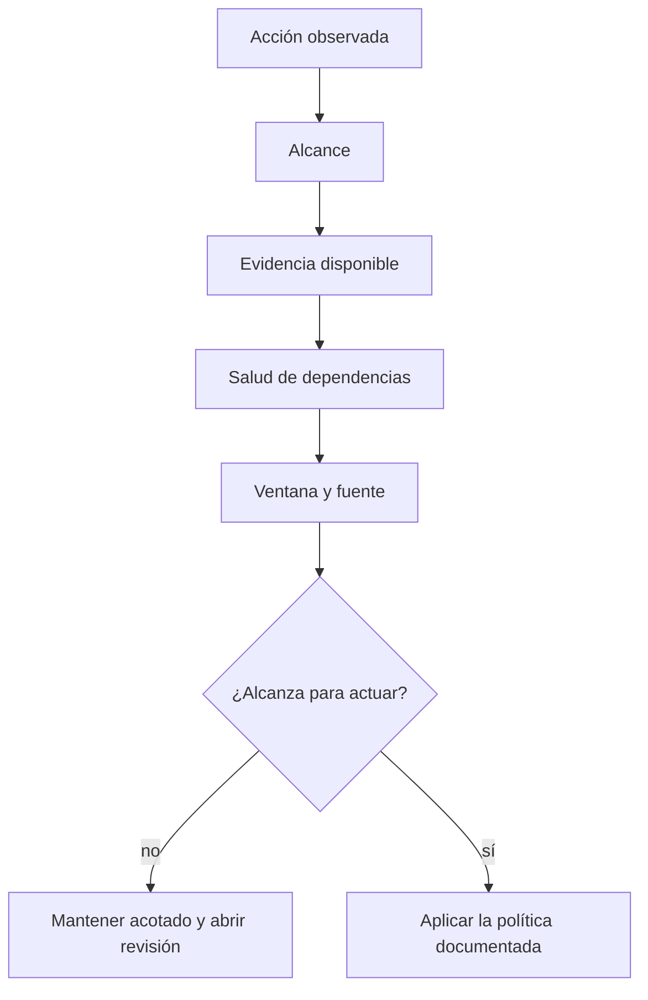

# Operación

## Qué mirar primero

1. Acción aplicada (`allow`, `observe`, `challenge`, `block` o resultado operacional `retry`)
2. Alcance de la acción (actor, ruta, operación, ventana y tenant)
3. Evidencia disponible e independencia de señales
4. Salud de dependencias (`degraded` o `quarantine` del servicio/módulo)
5. Ventana y fuente de los datos (ClickHouse o trazas en memoria del runtime)

Un panel sin datos significa que hay que revisar la fuente y su salud. No significa cero abuso.

## Orden de una revisión

## Decisiones y estados

Consulta también el [Canon de decisiones](reference/decision-canon.md).

| Valor | Tipo | Lectura operativa |
| --- | --- | --- |
| `allow` | Decisión | La solicitud continúa sin intervención |
| `observe` | Decisión | Continúa y conserva evidencia para revisión |
| `challenge` | Decisión | Pide una comprobación compatible con la capacidad del cliente |
| `block` | Decisión | La solicitud se deniega dentro de un alcance concreto |
| `retry` | Resultado operacional | Repetir tras `Retry-After` por indisponibilidad temporal del estado compartido; no es bloqueo |
| `degraded` / `quarantine` | Estado operativo | Dependencia o módulo limitado; nunca debe leerse como culpabilidad del visitante |

## Casos que requieren contexto

Una persona con VPN, navegador endurecido, bloqueadores, móvil inestable o una red compartida no debe bloquearse por una sola señal. Comprueba la secuencia completa y el alcance antes de cambiar un umbral.

## Copias selladas y vuelta atrás

Antes de una actualización conserva la revisión exacta, las imágenes y un backup verificado (`./abuseshield backup <edición>`, sellable con `ABUSE_SHIELD_BACKUP_PASSPHRASE_FILE` bajo el esquema `abuseshield-backup-v2`). Si salud, autenticación o decisiones cambian de forma inesperada, detén la ampliación y restaura el conjunto conocido ([Cambios y recuperación](guias/cambios.md)).

## Falso positivo y omisión

Un falso positivo es una persona legítima que recibió más fricción de la necesaria. Una omisión es actividad abusiva que avanzó más de lo esperado. En ambos casos conserva la solicitud reducida, la ruta, la ventana, la acción y las señales que realmente participaron. No subas un umbral global por un solo caso.
